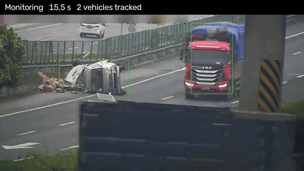
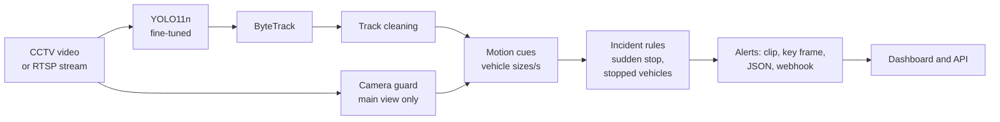
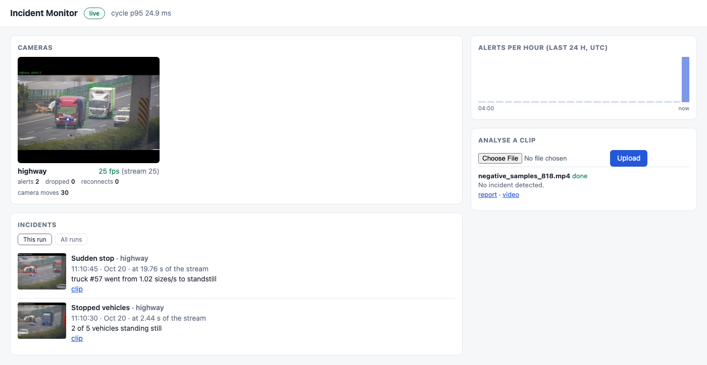

# Traffic Incident Detection from CCTV

Detects traffic crashes in low-quality CCTV footage and raises alerts in real time. A fine-tuned
YOLO11 detector and ByteTrack follow every vehicle; calibration-free motion cues flag sudden stops
and stranded vehicles; each incident becomes an alert with a clip, a key frame and a report.
Runs on video files or live RTSP cameras, several cameras per process, with a web dashboard.



<sub>Footage: TAD dataset ([Xu et al., IEEE Access 2025](#acknowledgements)), shown for research demonstration.</sub>

## Results

**Detector** - mAP@50 on the UA-DETRAC validation set, as is and with every frame degraded like poor CCTV footage:

| Detector | Clean | Degraded |
|---|---|---|
| YOLO11n, COCO pretrained | 0.538 | 0.398 |
| + fine-tuned on UA-DETRAC | 0.659 | 0.548 |
| **+ synthetic CCTV degradation** | **0.666** | **0.591** |

**Crash detection** - 70 held-out TAD clips (40 accidents, 30 normal), never used for tuning:

| Incident rules | Recall | Precision | False alarms / hour |
|---|---|---|---|
| Sudden stop + stopped vehicles | 0.50 | 0.87 | 31 |
| **+ queue filter** | **0.50** | **0.95** | **10** |

**Speed** - whole pipeline about 13 ms per frame; 2 cameras at 30 fps or 4 at 25 fps in one process.

| Detector runtime | Latency per frame (mean / p95) |
|---|---|
| PyTorch, GPU | 6.3 / 11.7 ms |
| ONNX Runtime, CPU | 11.2 / 12.3 ms |
| **CoreML FP16** | **5.3 / 5.6 ms** |

All exports were re-checked for crash-detection accuracy. More: [docs/results.md](docs/results.md).

## How it works



Key design choices:
- **Degraded training images** so the detector copes with night, blur and compression.
- **Camera guard** that ignores frames where an operator pans or zooms the camera.
- **Speed in vehicle sizes per second**, so no camera calibration is needed.
- **Queue filter** so traffic waiting at a red light is not reported as a crash.
- **Live system** that skips stale frames, reconnects dropped streams and batches several cameras.

## Quick start

```bash
python3 -m venv .venv && source .venv/bin/activate
pip install -e ".[service]"

incident-recon analyze clip.mp4 --weights best.pt                               # one clip -> incident report
incident-recon live --source rtsp://host:8554/cam1 --weights best.pt --seconds 0  # live alerts
incident-recon serve --live-dir outputs/live --weights best.pt                  # dashboard on http://127.0.0.1:8000
```

All commands, Docker, training and export: [docs/usage.md](docs/usage.md).

The dashboard during a live run: camera health, incidents with key frames and clips, alerts per
hour, and clip upload.



<sub>Footage: TAD dataset ([Xu et al., IEEE Access 2025](#acknowledgements)).</sub>

## Acknowledgements

This project uses two public datasets for non-commercial research. Thanks to their authors:

- **TAD**, traffic-accident clips from surveillance cameras, used to evaluate crash detection:
  Y. Xu, H. Hu, C. Huang, Y. Nan, Y. Liu, K. Wang, Z. Liu and S. Lian, "TAD: A Large-Scale Benchmark
  for Traffic Accidents Detection From Video Surveillance," *IEEE Access*, vol. 13, pp. 2018-2033, 2025.
  [doi:10.1109/ACCESS.2024.3522384](https://doi.org/10.1109/ACCESS.2024.3522384) ·
  [dataset](https://github.com/UnicomAI/UnicomBenchmark/tree/main/TADBench)
- **UA-DETRAC**, annotated traffic-camera video, used to fine-tune the vehicle detector:
  L. Wen, D. Du, Z. Cai, Z. Lei, M.-C. Chang, H. Qi, J. Lim, M.-H. Yang and S. Lyu, "UA-DETRAC: A New
  Benchmark and Protocol for Multi-Object Detection and Tracking," *Computer Vision and Image
  Understanding*, vol. 193, 102907, 2020.
  [doi:10.1016/j.cviu.2020.102907](https://doi.org/10.1016/j.cviu.2020.102907)

It is also built on [Ultralytics YOLO11](https://github.com/ultralytics/ultralytics) for detection
and [ByteTrack](https://github.com/ifzhang/ByteTrack) (Zhang et al., ECCV 2022) for tracking.

The datasets are not included in this repository; download them from their authors and follow
their terms.

<details>
<summary>BibTeX</summary>

```bibtex
@article{xu2025tad,
  author  = {Xu, Yajun and Hu, Huan and Huang, Chuwen and Nan, Yibing and Liu, Yuyao and Wang, Kai and Liu, Zhaoxiang and Lian, Shiguo},
  title   = {{TAD}: A Large-Scale Benchmark for Traffic Accidents Detection From Video Surveillance},
  journal = {IEEE Access},
  volume  = {13},
  pages   = {2018--2033},
  year    = {2025},
  doi     = {10.1109/ACCESS.2024.3522384}
}

@article{wen2020detrac,
  author  = {Wen, Longyin and Du, Dawei and Cai, Zhaowei and Lei, Zhen and Chang, Ming-Ching and Qi, Honggang and Lim, Jongwoo and Yang, Ming-Hsuan and Lyu, Siwei},
  title   = {{UA-DETRAC}: A New Benchmark and Protocol for Multi-Object Detection and Tracking},
  journal = {Computer Vision and Image Understanding},
  volume  = {193},
  pages   = {102907},
  year    = {2020},
  doi     = {10.1016/j.cviu.2020.102907}
}

@inproceedings{zhang2022bytetrack,
  author    = {Zhang, Yifu and Sun, Peize and Jiang, Yi and Yu, Dongdong and Weng, Fucheng and Yuan, Zehuan and Luo, Ping and Liu, Wenyu and Wang, Xinggang},
  title     = {{ByteTrack}: Multi-Object Tracking by Associating Every Detection Box},
  booktitle = {European Conference on Computer Vision (ECCV)},
  year      = {2022}
}
```
</details>

## Licence

The code is released under the [MIT licence](LICENSE). The datasets keep their own terms.
