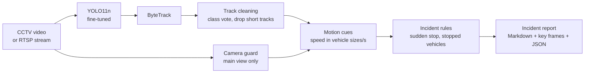

# Design

## Pipeline

## Design decisions

| Problem | Solution |
|---|---|
| Crash footage is low resolution, often infrared, dark, blurred and compressed | Fine-tuned YOLO11n on UA-DETRAC with **synthetic CCTV degradation** |
| UA-DETRAC does not label people and two-wheelers | **Pseudo-labels** from a large COCO model (YOLO11x) |
| A vehicle flips between car and truck; short-lived junk IDs | **Track cleaning**: confidence-weighted class vote, tracks under 0.5 s dropped |
| Operators pan or zoom towards a crash | **Camera guard**: phase correlation on a 3x3 tile grid; only the main view is analysed |
| No calibrated cameras for km/h | **Calibration-free speed**: distance moved in vehicle sizes per second |
| Queues at red lights look like a crash aftermath | **Queue filter**: stopped vehicles packed among other stopped vehicles are a queue |

## Live system and service

- The live detector keeps the last 20 s of tracks and runs the same rules once a second.
- Each alert saves a clip, a key frame and a JSON record, and can be POSTed to a webhook.
- Live sources drop stale frames instead of falling behind and reconnect when a stream is lost.
- Several cameras share one batched detector; tracking and alerts stay per camera.
- The camera process and the web service share only atomically written files, so either can
  restart without stopping the other. The service offers a dashboard, a JSON API and
  Prometheus metrics.
